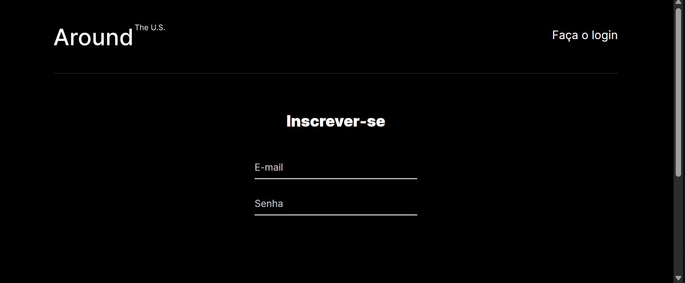

# Tripleten web_project_around_auth

**EUA Afora** com registro e autorização de usuários — Projeto 17 do bootcamp de Desenvolvimento Web da TripleTen.

## Sobre o projeto

Continuação do projeto "EUA Afora" (React). Agora toda a funcionalidade do aplicativo está disponível apenas para usuários autorizados: é preciso se registrar e fazer login para ver e editar o perfil e os cartões.

## Funcionalidades

- **Registro** de usuário (`/signup`) com e-mail e senha
- **Login** (`/signin`) com recebimento de um token JWT
- **Rota protegida** `/`: usuários não autorizados são redirecionados para o login, qualquer que seja a rota acessada
- **Login automático**: o token fica salvo no `localStorage` e é verificado ao abrir o site
- **Logout** pelo botão "Sair", que apaga o token
- **Cabeçalho** diferente para usuários autorizados (e-mail + "Sair") e não autorizados (links "Inscrever-se" / "Faça o login")
- **InfoTooltip**: janela modal que informa se o registro foi bem-sucedido ou se ocorreu um erro
- Funcionalidades do projeto anterior: editar perfil e avatar, adicionar, curtir e excluir cartões

## Capturas de tela

### Login


### Registro


### Página principal (usuário autorizado)


### InfoTooltip


## Tecnologias

- React 18 + Vite
- React Router 6 (`Routes`, `Navigate`, `useNavigate`, `useLocation`)
- Context API (`CurrentUserContext`)
- API REST com `fetch` e autenticação por JWT (`Authorization: Bearer <token>`)
- CSS com metodologia BEM

## Estrutura

- `src/components/` — componentes (`App`, `Header`, `Main`, `Login`, `Register`, `ProtectedRoute`, `InfoTooltip`, pop-ups…)
- `src/utils/auth.js` — registro, autorização e verificação do token
- `src/utils/api.js` — requisições do EUA Afora (perfil e cartões)
- `src/utils/token.js` — salvar, ler e remover o token do `localStorage`
- `src/blocks/` — estilos por bloco (BEM)

## Como executar

```bash
npm install
npm run dev
```

O aplicativo abre em `http://localhost:3000`.

## Design

Layout baseado no [design do Figma](https://www.figma.com/design/mTJsFEjqKEVD8TyXAhhGzO/Sprint-17-Around-US-PT?node-id=0-1) fornecido pela TripleTen.